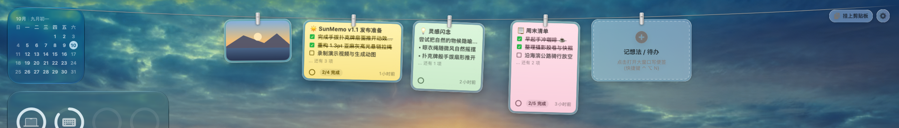
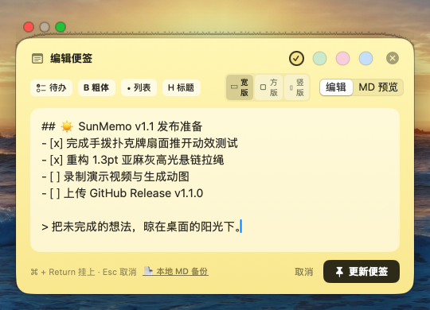
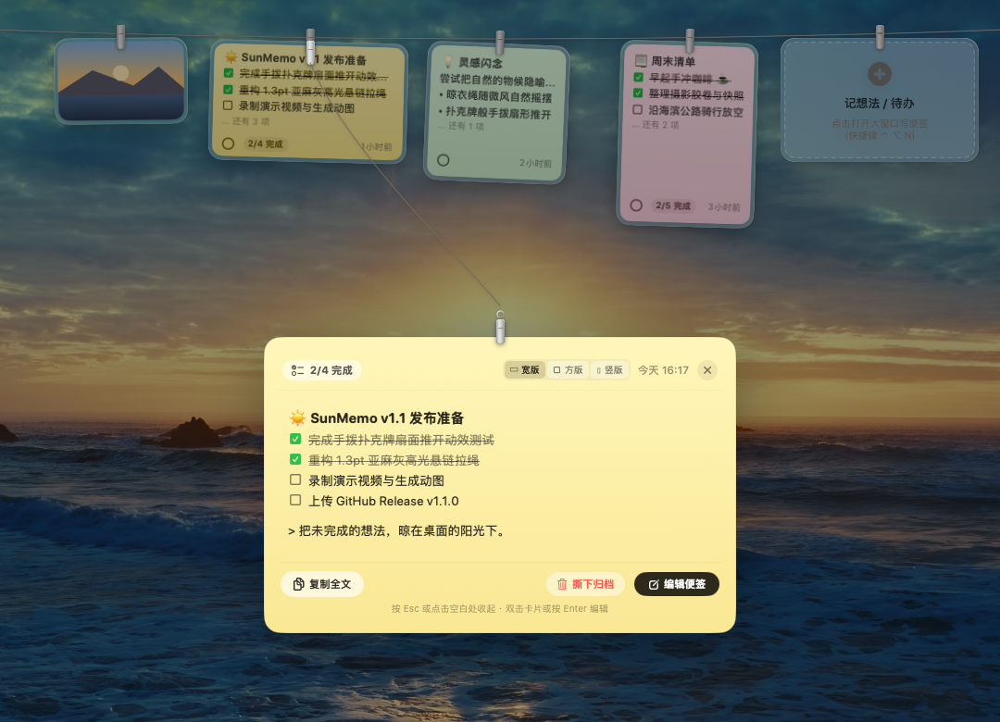

# ☀️ SunMemo · 晾想法

> **把未完成的想法与待办，晾在桌面阳光下。**  
> An elegant macOS clothesline for your thoughts, to-do lists, and screenshots.

<p align="center">
  <strong>简体中文</strong> &nbsp;·&nbsp; <a href="README_en.md">English</a>
</p>

<p align="center">
  
  <br><br>
  <strong>数据存本地 · 无账号无统计 · 极速流畅 · 兼容 macOS 13+ (Ventura / Sonoma / Sequoia)</strong>
  <br><br>
  <a href="https://github.com/km-open-lab/SunMemo/releases/latest"><strong>📦 下载最新 DMG 安装包 (v1.1.0)</strong></a>
  &nbsp;·&nbsp;
  <a href="#-快捷键与操作手势">快捷键一览</a>
  &nbsp;·&nbsp;
  <a href="#-源码编译-build-from-source">源码编译</a>
</p>

<p align="center">
  
</p>

---

## 🌟 核心特色 (Features)

### ☀️ 1. 桌面顶部晾衣绳 (Top Clothesline)
- 鼠标滑向屏幕顶部边缘或按快捷键 `⌃ ⌥ ␣`，晾衣绳如羽毛般轻盈垂下。
- **手拨扑克牌扇面让位**：光标划过便签时，目标卡片微步迈前，两侧卡片如掌中扑克牌般扇形推开侧倾，杜绝失真变形。
- **动态自适应叠放**：卡片随风自然微动；便签增多时智能压缩步长，从容收纳数十条灵感与待办。

### 📝 2. 便签速记、多比例自适应与 Markdown 工具栏
<p align="center">
  
</p>

- 按 `⌃ ⌥ N` 随时呼出原生独立速记窗口，不打断手头工作。
- **三种黄金比例自由切换**：支持宽版（`16:10`）、方版（`1:1`）、竖版（`3:4`）三种尺寸药丸，适配从横向代码、灵感短句到纵向步骤清单等多元场景。
- **完整 Markdown 工具栏**：支持一键插入 `☑️ 待办清单`、`B 粗体`、`• 无序列表`、`H 标题`，提供 `编辑 / MD 预览` 双模式实时渲染。
- **绳上直接打勾**：无需点开编辑，悬挂状态下即可点击 `- [ ]` 待办复选框打勾，实时同步进度条。
- **多色卡片主题**：支持暖阳黄、薄荷绿、樱花粉、晴空蓝四种清爽色彩。

### 🔍 3. 单击放大沉浸查看与 1.3pt 悬链拉绳 (Hero Preview)
<p align="center">
  
</p>

- **物理松弛感拉绳牵引**：单击绳上卡片即可取下放大居中查看；晾衣绳在上方稳稳常驻，1.3pt 亚麻灰高光双色悬链曲线（Catenary Bezier）如同一根轻柔的伸缩拉绳，连接着顶端的木夹与下方的金属扣环。
- **沉浸交互与快捷动作**：大图完整支持 Markdown 样式渲染与待办打勾，提供一键切换比例、`📋 复制全文`、`🗑 撕下归档`、`✎ 双击编辑` 等完备操作，按 `Esc` 或点击空白处平滑收起。

### 📸 4. 截图与剪贴板接管 (Screenshots & Clipboard)
- 截屏或复制图片/文字后，按 `⌃ ⌥ V` 即可瞬间挂上晾衣绳。
- 截图卡片支持单击放大查看、双击一键复制，长按即可开启 macOS 原生 Markup 画笔标注。

### 💾 5. 本地实时 Markdown 同步与防丢归档 (Dual Markdown Persistence)
- **只读 Markdown 导出**：每次便签变化，SunMemo 都会把所有在绳便签和归档整份导出到 `~/Documents/SunMemo.md`。这是**单向导出**：文件每次都会被整份重写，在文件里做的修改会被覆盖、不会回到 SunMemo；要改便签请在 SunMemo 里编辑。
- **防丢稿**：编辑中的内容会自动存为草稿，关闭编辑器或切换到别的便签时会先询问；便签文件采用原子写入，写入失败会弹窗提示。
- **撕下便签带时间戳归档**：点击卡片撕下后自动沉淀至 `# 📦 历史已撕下便签归档`，精确记录创建时间与撕下时间戳。
- 可以用 **Obsidian、Typora、VS Code** 等打开查看和检索；需要二次整理时请先另存一份。

### 🔄 6. 自动更新检测与设置管理 (Auto-Update & Preferences)
- 内置 GitHub Releases 自动版本检查，新版本发布时在菜单栏友好提示，一键跳转更新。
- 专属偏好设置面板，支持自定义录制全局快捷键与开关剪贴板自动挂绳。

### 🛡️ 7. 本地优先与隐私 (Local-first & Private)
- **0 账号体系**、**0 统计与追踪**、**0 第三方 SDK**。
- **唯一的联网行为是检查更新**：默认开启，启动时和之后每 24 小时请求一次 GitHub Releases API（`api.github.com`），只读取最新版本号，不上传任何便签或截图。可在「偏好设置 → 软件版本与自动更新」中关闭。
- 便签、截图与配置都保存在本机。注意：如果开启了 iCloud「桌面与文稿」同步，`~/Documents/SunMemo.md` 会随文稿目录一起同步到 iCloud。

---

## ⌨️ 快捷键与操作手势

| 操作 | 动作说明 |
| :--- | :--- |
| <kbd>⌃</kbd>&thinsp;<kbd>⌥</kbd>&thinsp;<kbd>␣</kbd> | **呼出 / 收起晾衣绳**（下拉或隐藏顶部便签绳） |
| <kbd>⌃</kbd>&thinsp;<kbd>⌥</kbd>&thinsp;<kbd>N</kbd> | **弹出速记窗口**（写想法、列待办） |
| <kbd>⌃</kbd>&thinsp;<kbd>⌥</kbd>&thinsp;<kbd>V</kbd> | **挂上剪贴板内容**（将截图或复制的文本挂上绳） |
| **单击便签卡片** | 弹出便签大窗口进行查看与二次编辑 |
| **单击待办复选框** | 在卡片上直接勾选或取消待办事项（`- [ ]` ↔ `- [x]`） |
| **拖动卡片** | 拖拽至飞书、微信、访达、Obsidian 即刻分享；拖至废纸篓撕下丢弃 |
| **点击卡片右上角 ×** | 撕下便签，并在本地 `SunMemo.md` 中自动归档记录撕下时间 |
| **长按图片卡片** | 开启 macOS 原生 Markup（标记画笔涂鸦） |

*注：以上所有全局快捷键均可在菜单栏「偏好设置与快捷键...」中任意修改。*

---

## 📦 下载与安装 (Installation)

### 方式 1：直接下载 DMG 安装包（推荐）
1. 前往 [Releases 页面](https://github.com/km-open-lab/SunMemo/releases/latest) 下载最新版本的 `SunMemo-1.0.0.dmg`。
2. 双击打开 DMG，将 **SunMemo.app** 拖动至 **Applications** 文件夹即可。
3. 首次启动时，SunMemo 会弹出欢迎与使用引导卡片，按指引开启即可畅享。

### 方式 2：源码编译 (Build from source)
项目采用纯 Swift + SwiftUI + AppKit 构建，无需安装庞大的 Xcode 完整工程即可直接用 SwiftPM 构建通用架构（Universal Binary: Apple Silicon + Intel）：

```sh
# 克隆仓库
git clone https://github.com/km-open-lab/SunMemo.git
cd SunMemo

# 编译并生成 SunMemo.app
bash scripts/build-app.sh release

# 运行应用
open build/SunMemo.app

# 打包 DMG 安装盘
bash scripts/make-dmg.sh
```

---

## 🛠️ 项目结构与技术架构

```text
SunMemo/
├── Package.swift                    # SwiftPM 项目清单
├── Sources/SunMemo/
│   ├── AppDelegate.swift            # 状态栏菜单、全局通知分发与生命周期
│   ├── Line.swift                   # 晾衣绳核心模型、数据持久化与微风摆动物理模拟
│   ├── LineView.swift               # 顶部透明画板、绳索抛物线几何与动态扇面叠放布局
│   ├── PeggedView.swift             # 便签卡片视图、交互复选框点击、悬停放大聚焦
│   ├── QuickMemoWindow.swift        # 原生独立速记弹窗、Markdown 工具栏与色彩切换
│   ├── MemoSyncManager.swift        # 单向导出 Markdown（只读备份）与撕下时间戳归档
│   ├── WelcomeWindow.swift          # 新版 SwiftUI 欢迎使用与引导弹窗
│   ├── SettingsWindow.swift         # 快捷键自定义录制与防误触管理
│   ├── ClipboardWatcher.swift       # 智能剪贴板监听与一键上绳
│   ├── HotKeyManager.swift          # Carbon 全局热键底层监听与分发
│   └── Resources/                   # 多语言本地化支持 (简体中文, English, Español)
├── scripts/
│   ├── build-app.sh                 # 通用二进制架构编译与签名脚本
│   ├── make-dmg.sh                  # 磁盘映像 DMG 自动化打包与 Finder 布局排版
│   ├── make-icon.swift              # 用纯 CoreGraphics / AppKit 绘制 1024x1024 渐变图标
│   └── make-dmg-background.swift    # DMG 视网膜安装背景图生成脚本
└── LICENSE                          # MIT 开源协议与版权声明
```

---

## 👥 贡献者与共同作者 (Contributors & Authors)

- **发起与核心开发**：[@km-open-lab](https://github.com/km-open-lab)
- **核心贡献者 / 共同作者**：
  - [@whatwoods](https://github.com/whatwoods) (Way) — 核心贡献：便签防丢草稿机制、文件原子写入与损坏隔离、跨进程安全加固、全局快捷键冲突防御与文档校验。

---

## 📄 开源许可与致谢 (License & Credits)

- 本项目基于 **MIT License** 开源。
- 灵感与基础物理摆动渲染来源于 Alejandro Buján 的优秀作品 [Tendedero](https://github.com/alejandrobujan/tendedero)。
- SunMemo 按照上游许可证要求，使用了完全独立的全新品牌命名、独立设计的暖阳便签图标（`scripts/make-icon.swift`）、重构优化的多色便签速记体系、交互式待办清单系统、扇面自适应叠放算法、全新的 SwiftUI 引导界面以及 `SunMemo.md` 本地 Markdown 导出与撕下归档。
